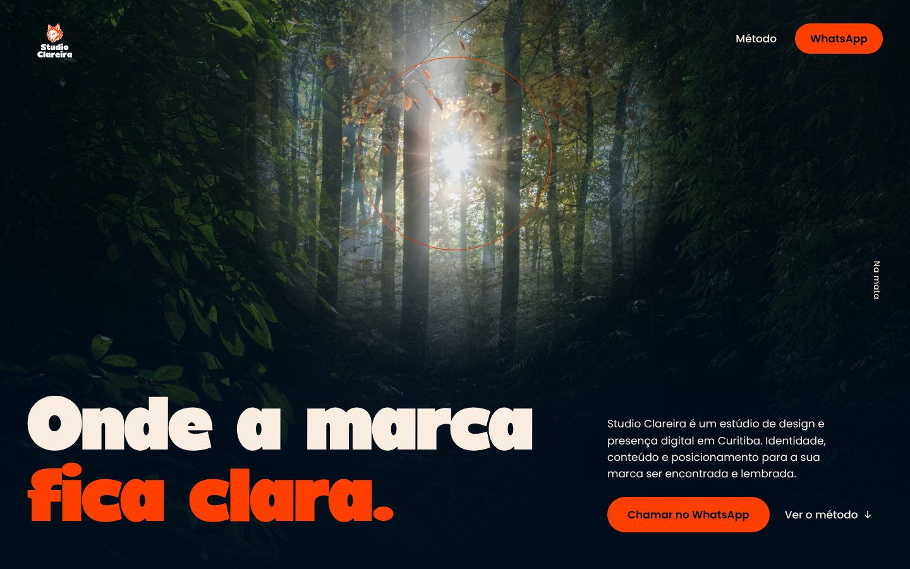
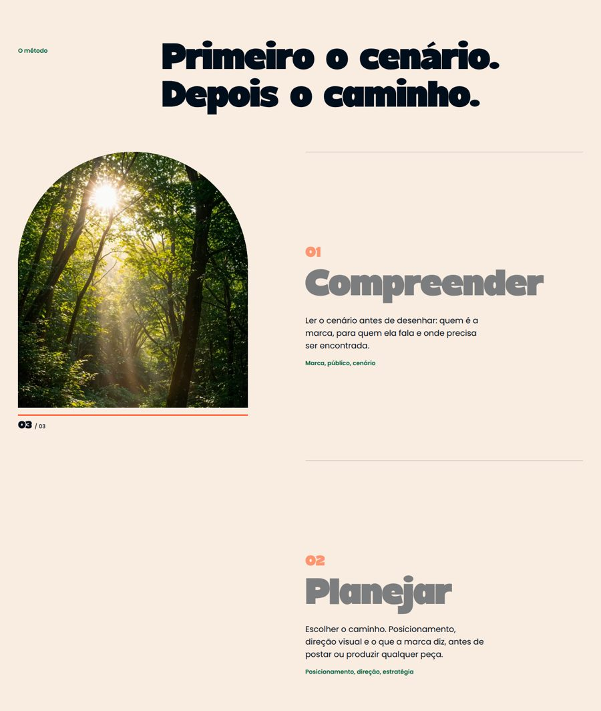
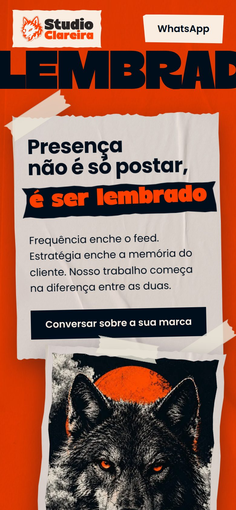
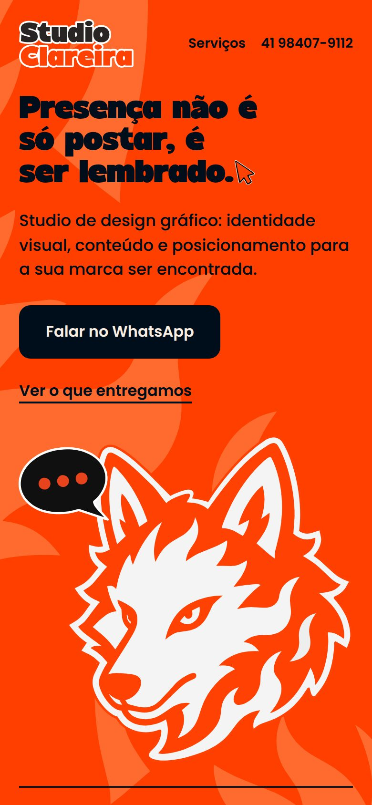
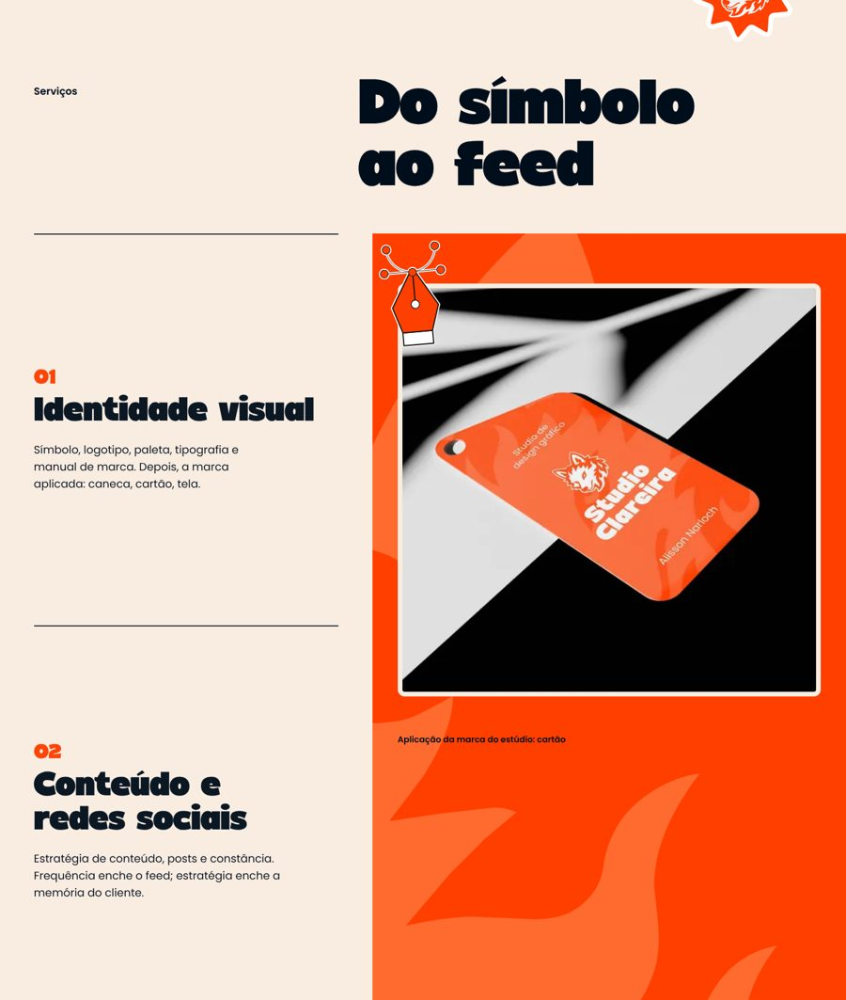
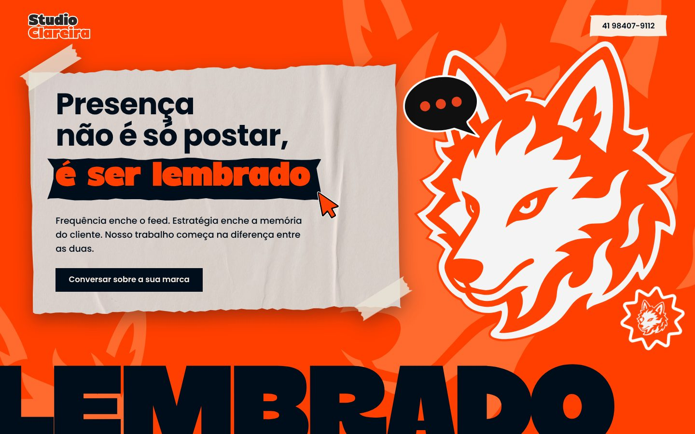
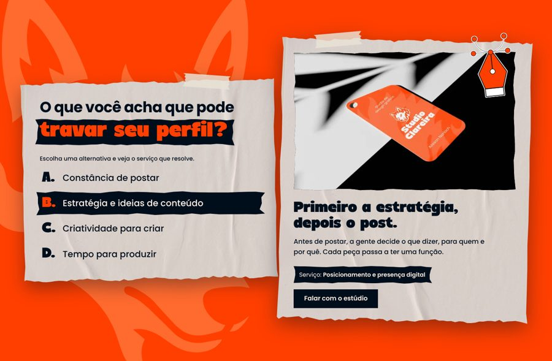

# Studio Clareira: landing page (direções para escolher)

Quatro direções para a primeira dobra da landing page do Studio Clareira. Cada uma tem o hero e uma seção, e todas
foram construídas a partir do manual de marca: Chunk + Poppins, paleta oficial, lobo e elementos de apoio.
**Ainda não é o site completo.** Escolhida a direção (ou uma mistura), a página inteira é construída sobre ela.

## A · Clareira: `/m/clareira`
A metáfora do manual levada ao pé da letra. Ao rolar, a mata escura se abre num círculo de luz até a tela ficar
clara. A seção seguinte é o método (compreender, planejar, construir), com a foto da trilha subindo do chão até o sol.

| Desktop | Celular | Seção 2 |
|---|---|---|
|  |  |  |

## B · Cartaz: `/m/cartaz`
O site fala a mesma língua dos posts do estúdio: papel rasgado, fita, o lobo em meio-tom com a lua laranja e
"LEMBRADO" gigante. A seção seguinte é o post "O que pode travar seu perfil?" em versão interativa: você escolhe
a alternativa e o estúdio responde.

| Desktop | Celular | Seção 2 |
|---|---|---|
|  |  |  |

## C · Brasa: `/m/brasa`
A marca como objeto: laranja chapado, o lobo-chama grande e os adesivos do manual (cursor, balão, selo). Os adesivos
podem ser arrastados e o lobo acompanha o mouse. A seção seguinte são os serviços, mostrados com as aplicações reais
da marca (cartão, caneca, tablet).

| Desktop | Celular | Seção 2 |
|---|---|---|
|  |  |  |

## D · Colagem (B + C): `/m/colagem`
Junta o Cartaz e a Brasa num mundo só: coisas coladas num muro laranja. O fundo é o laranja com o lobo-chama, o lobo
grande e os adesivos arrastáveis da Brasa. O título vai na folha rasgada com fita do Cartaz, com a tarja "é ser
lembrado" e "LEMBRADO" gigante no pé. A seção seguinte é o quiz "O que pode travar seu perfil?": cada alternativa
mostra o serviço que resolve aquele problema, com a foto de aplicação da marca.

| Desktop | Celular | Seção 2 |
|---|---|---|
|  |  |  |

## O que precisa de confirmação
- **Serviços.** Tirei do material três: identidade visual; conteúdo e redes sociais; posicionamento e presença
  digital. Estão marcados `RASCUNHO` no código.
- **Textos de apoio.** Saíram dos posts e do manual. As respostas do quiz (B e D), o mapeamento alternativa → serviço (D) e os textos do método (A) são rascunho.
- **Contato.** Só o WhatsApp 41 98407-9112, que aparece nos posts. Faltam Instagram e e-mail.
- **Fotos de floresta.** São as da apresentação da marca. Origem e licença a confirmar antes de publicar.
- **Clientes.** Versátil Dedetizadora, Granja Aluy e Terreiro Temox só entram como cases com autorização.

## Rodar localmente
```bash
npm install
npm run dev     # http://localhost:3000, com as direções em /m/clareira, /m/cartaz, /m/brasa e /m/colagem
```
Feito em Next 16 (App Router) com CSS Modules, sem biblioteca de UI. O briefing usado pelos designers está em
[`BRIEFING.md`](BRIEFING.md).
